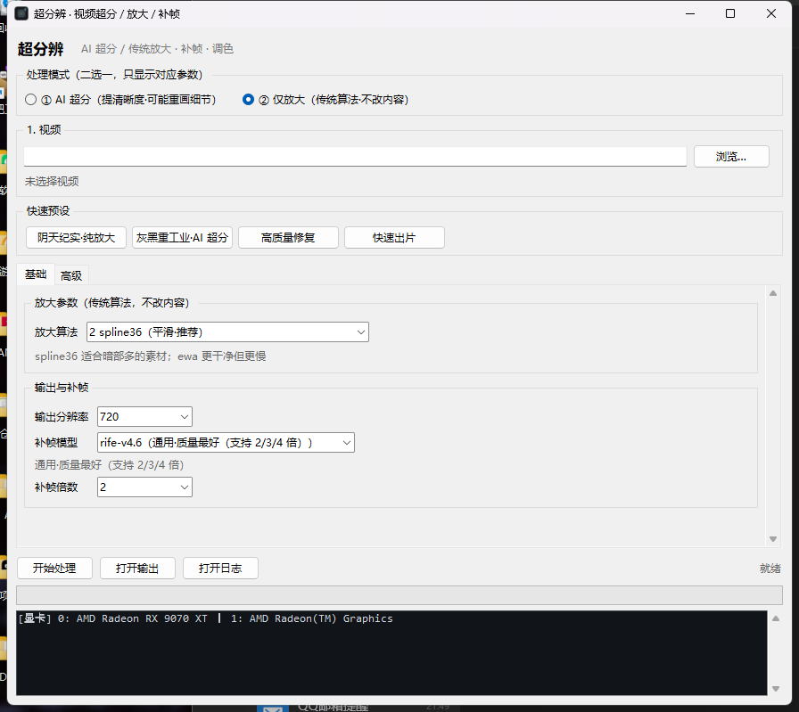

# 超分辨（Chaofenbian）

视频超分 + 补帧 + 图片超分，一个 Windows 下开箱即用的图形/命令行工具。

全中文界面 · 纯本地运行 · 基于开源引擎（Real-ESRGAN / Real-CUGAN / RIFE / FFmpeg）

[](https://github.com/acev500/ADCE)
[](https://github.com/acev500/ADCE/commits/main)
[](https://github.com/acev500/ADCE)


觉得有用就点个 ⭐ —— 手机扫右边这个码也能直接打开。



---

## 功能

| 功能 | 说明 |
|---|---|
| 视频超分 | 2/3/4 倍放大，可选 Real-ESRGAN（通用/动漫/写实）或 Real-CUGAN（保守，不易重画人脸） |
| 视频补帧 | RIFE 2/3/4 倍插帧（24 → 48 / 72 / 96 fps） |
| 图片超分 | 单张或整个文件夹批量，输出 PNG 无损 |
| 后处理 | 去色带 deband、去压缩块 deblock、锐化 CAS |
| 调色 | 三套内置 LUT（灰黑重工业 / 冷蓝档案 / 暖橙工业）+ 自定义参数 |
| 分段处理 | 长视频按段拆开再合并，控制磁盘占用 |
| 无头调用 | 支持 `--quiet` / `--json` / 指定参数，方便脚本和批量流水线 |

---

## 快速开始

### 1. 准备 `bin\`（**必须**，不放仓库）

`bin\` 里是引擎和模型，加起来 500 MB 以上，不进 Git。自己下好放进去：

```
bin\
  realesrgan-ncnn-vulkan.exe          https://github.com/xinntao/Real-ESRGAN/releases
  realcugan-ncnn-vulkan.exe           https://github.com/nihui/realcugan-ncnn-vulkan/releases
  rife-ncnn-vulkan.exe                https://github.com/nihui/rife-ncnn-vulkan/releases
  ffmpeg.exe                          https://www.gyan.dev/ffmpeg/builds/  （或 BtbN 的静态版）
  vcomp140.dll / vcomp140d.dll        （ncnn 运行库，引擎包里通常自带）
  models\                             超分模型（*.param + *.bin）
  models-pro\ models-se\              Real-CUGAN 模型
  rife-v4.6\ rife-anime\ rife-HD\ rife-UHD\   补帧模型
```

模型文件从对应引擎的 release 包里拿，解压到同名目录即可。

### 2. 用图形版

双击 `超分辨_图形版.exe`。

**最上面先选「处理对象」**：视频或图片，选哪个下面就只显示哪一套参数。

```
处理对象   ○ 视频（超分 + 补帧）      ● 图片（只超分，不补帧）
```

### 3. 用命令行版

```
超分辨.exe D:\video\a.mp4
```

拖文件到 exe 图标上也行。交互式会问你参数，直接回车走默认。

---

## 无头调用（脚本 / 批处理 / CI）

```bash
# 视频：静默，指定模型、倍数、输出目录
超分辨.exe D:\in\a.mp4 --quiet --model realesr-animevideov3 --scale 2 --mul 2 --out D:\out

# 图片：单张放大 4 倍
超分辨.exe D:\in\pic.png --quiet --scale 4 --out D:\out

# 图片：整个文件夹批量，结果用 JSON 回给脚本
超分辨.exe D:\in\imgs --json --scale 2
```

`--json` 会在结束时往 stdout 打一行 JSON：

```json
{"ok": true, "type": "image", "done": 3, "total": 3,
 "out_dir": "D:\\out",
 "outputs": ["D:\\out\\a_up2x.png", "D:\\out\\b_up2x.png", "D:\\out\\c_up2x.png"],
 "seconds": 4.21,
 "log": "D:\\超分辨\\日志\\img_imgs_20261114_122236.log"}
```

退出码：`0` 成功，`2` 有文件失败，`1` 环境/参数错误。

### 参数表

| 参数 | 说明 |
|---|---|
| `--auto` | 无交互，全部用 `config.json` 里存的参数 |
| `--quiet` | 静默，不打印参数菜单（隐含 `--auto`） |
| `--json` | 结束时输出一行 JSON（隐含 `--quiet`） |
| `--model NAME` | 超分模型名，如 `realesr-animevideov3` |
| `--scale N` | 放大倍数 2/3/4 |
| `--rife NAME` | 补帧模型名，如 `rife-v4.6` |
| `--mul N` | 补帧倍数 2/3/4 |
| `--target N` | 输出分辨率 `1080` / `720` / `原始` |
| `--crf N` | 画质 CRF，越小越好越大 |
| `--out DIR` | 输出目录（默认 `输出\`） |
| `--help` | 帮助 |

---

## 目录结构

```
超分辨.exe          命令行版
超分辨_图形版.exe    图形版（tkinter）
src\
  chaofenbian.py    命令行主程序（视频 + 图片 + 无头）
  gui.py            图形界面
  installer.py      安装辅助
bin\                引擎与模型（自己准备，见上）
lut\                调色 LUT（.cube）
work\               中间文件（可删）
输出\               成片与超分后的图片
日志\               每次运行的完整日志
config.json         记住的参数（删掉恢复默认）
```

---

## 注意事项

1. **先超分补帧，最后叠字幕**。字幕先烧进去再超分，字会糊。
2. 补帧会让 AI 生成画面的瑕疵更明显，24 → 48 fps 通常够用，别贪。
3. `work\` 会涨到几十 GB，处理完记得清。
4. 中文路径没问题，但路径里别带 `&`、`|` 这类 shell 特殊字符。
5. 图片模式不走 LUT 和颗粒，只做超分；要调色处理完自己叠。

---

## 许可

本仓库代码（`src\`）为自用工具，随便改。

依赖的第三方组件各自许可：

| 组件 | 许可 |
|---|---|
| Real-ESRGAN（realesrgan-ncnn-vulkan） | BSD-3-Clause，可商用 |
| Real-CUGAN（realcugan-ncnn-vulkan） | MIT，可商用 |
| RIFE（rife-ncnn-vulkan） | MIT，可商用 |
| FFmpeg | LGPL / GPL（按构建而定），可商用 |

模型文件版权归各上游项目所有，本仓库不附带。

---

## 更新记录

- **v1.2** 图形版顶部加「处理对象」切换；补 `BASE` 路径判定
- **v1.1** 加入图片超分（单张 + 文件夹批量）
- **v1.0** 视频超分 + 补帧
